  

<a href="https://paquereauman.github.io/Paquereauman/"><b>🌐 Portfolio</b></a> &nbsp;&nbsp;·&nbsp;&nbsp;
<a href="#-projects"><b>🚀 Projects</b></a> &nbsp;&nbsp;·&nbsp;&nbsp;
<a href="#-contact"><b>📫 Contact</b></a>

  

  

  <b>🚀 Projects</b>

| Project | Category | Platform | Links |
| :--- | :---: | :---: | :---: |
| 🥖 **Français A1 (Je parle baguette)** Interactive French course for Chinese speakers: 17 chapters, ~760 words, neural audio, server-graded quizzes, spaced repetition, avatars and monthly rankings. | `Education / FLE` | **Web App** | [Live App](https://paquereauman.github.io/apprendre-francais-a1/) · [Code](https://github.com/Paquereauman/apprendre-francais-a1) |
| ⚡ **IP Unlocker** Cross-platform utility for unblocking AI tools (Claude, ChatGPT, Gemini). Silent Sing-box TUN L3 engine, WARP relay, auto-proxy detection, anti-WebRTC leak. | `Network / AI Utility` | **Windows · macOS** | [Downloads](https://github.com/Paquereauman/cu-bootstrap/releases/latest) · [Repo](https://github.com/Paquereauman/cu-bootstrap) |
| 🐱 **Stickaru** Sticker & meme library: search Tenor, GIPHY, Telegram without API keys, 1-click copy with transparency into Discord, WhatsApp, Slides. | `Desktop Tool` | **Windows** | [Installer](https://github.com/Paquereauman/stickaru/releases/latest) · [Code](https://github.com/Paquereauman/stickaru) |
| 🎸 **Barré guitare** Web app for guitarists: personalized song list with chords, synchronized YouTube lessons, and real-time audio tuner. | `Web App / Music` | **Web App** | [Open App](https://paquereauman.github.io/Paquereauman/barre-guitare/) · [Code](./barre-guitare) |
| 🎙️ **Dictaphone DeepSeek FR** Free French voice dictation for DeepSeek: Chrome extension paired with a 100% local Whisper speech-to-text server. | `AI / Voice` | **Chrome + Python** | [Code & Setup](https://github.com/Paquereauman/dictaphone-deepseek-fr) |

 

  <b>📫 Contact</b>

Got an idea, a challenge to tackle, or want to collaborate?  
Feel free to reach out directly:

### ✉️ **[bpaquereau@hotmail.fr](mailto:bpaquereau@hotmail.fr)**

 

Made with curiosity and coffee.

