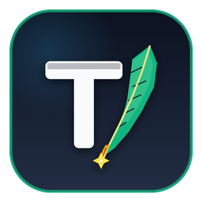
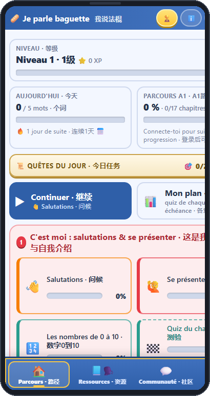
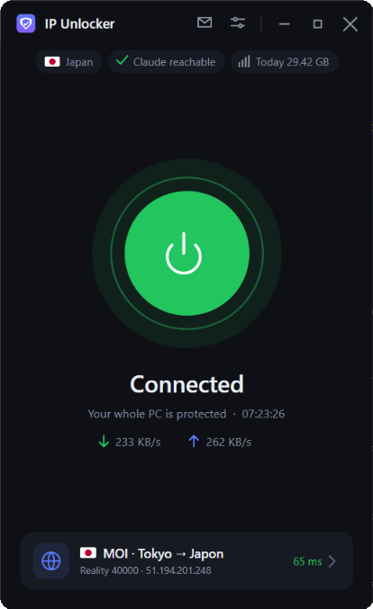
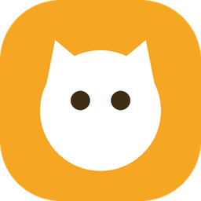
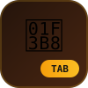

 

| Project | Preview | Platform | Links&nbsp;&nbsp;&nbsp;&nbsp;&nbsp;&nbsp; |
| :--- | :---: | :---: | :--- |
| ✍️ **Texteur** Fast, reliable French grammar & style checker and text editor (Rust): hand-written rules, Grammalecte, spaCy and a CamemBERT detector, 100% local. Built for long books mixing French, pinyin and Chinese characters. |  | **Windows** | •&nbsp;[Source&nbsp;Code](https://github.com/Paquereauman/texteur) •&nbsp;[Progress](https://github.com/Paquereauman/texteur/blob/main/PROGRES.md) |
| 🥖 **Français A1 (Je parle baguette)** Interactive French course for Chinese speakers: 17 chapters, ~760 illustrated words, neural audio, server-graded quizzes. |  | **Web App** | •&nbsp;[Live&nbsp;App](https://paquereauman.github.io/apprendre-francais-a1/) •&nbsp;[Source&nbsp;Code](https://github.com/Paquereauman/apprendre-francais-a1) |
| ⚡ **IP Unlocker** High-performance desktop utility for unblocking AI platforms (Claude, ChatGPT). Silent Sing-box TUN engine, WARP relay & anti-leak. |  | **Win · Mac** | •&nbsp;[Downloads](https://github.com/Paquereauman/cu-bootstrap/releases/latest) •&nbsp;[Repository](https://github.com/Paquereauman/cu-bootstrap) |
| 🐱 **Stickaru** Desktop sticker & meme library: Tenor, GIPHY, Telegram search without API keys. 1-click transparent copy into Discord & Slides. |  | **Windows** | •&nbsp;[Installer](https://github.com/Paquereauman/stickaru/releases/latest) •&nbsp;[Source&nbsp;Code](https://github.com/Paquereauman/stickaru) |
| 🎸 **Barré guitare** Web app for guitarists: custom song & chord sheets, synchronized YouTube video lessons, and real-time audio tuner via microphone. |  | **Web App** | •&nbsp;[Open&nbsp;App](https://paquereauman.github.io/Paquereauman/barre-guitare/) •&nbsp;[Source&nbsp;Code](./barre-guitare) |
| 🎙️ **Dictaphone DeepSeek FR** 100% private French voice dictation for DeepSeek: Chrome extension paired with local Whisper STT server. Zero cloud recording. |  | **Chrome · Py** | •&nbsp;[Code&nbsp;&amp;&nbsp;Setup](https://github.com/Paquereauman/dictaphone-deepseek-fr) |

 

  

<b>📫 Contact</b>
  
Got an idea, a challenge to tackle, or want to collaborate?  
Feel free to reach out directly:
  

### ✉️ **[paquereauman5@outlook.com](mailto:paquereauman5@outlook.com)**

Made with curiosity and coffee.

